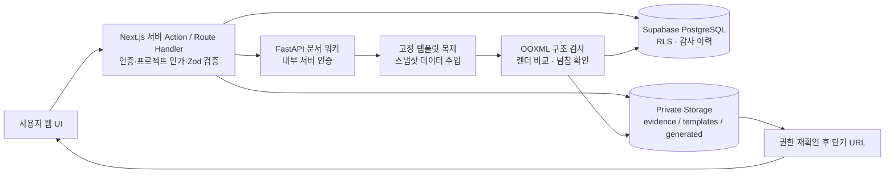
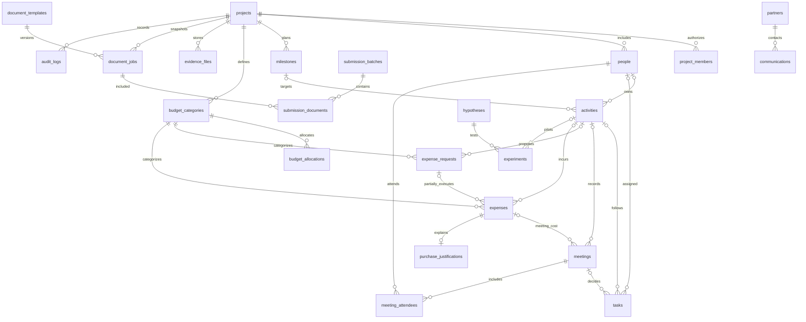

# 데이터 흐름과 DB 관계 설계

설계안이며 M1에는 DB 및 RLS를 생성하지 않는다. 기술 경계는 원 명세를 따른다.

활동을 중심으로 일정·회의·업무·지출을 연결하고, 증빙은 원본 파일 ID를 재사용한다. 일정은 activities의 시작/종료와 milestones 기한을 표시하는 읽기 모델로 시작하여 별도 일정을 중복 입력하지 않는다. people은 업무 담당자·회의 참석자 등 참여 인물, project_members는 로그인 사용자 권한이며 둘은 다르다.

## 테이블 설계 보완

原 명세의 22개 테이블이 기준이다. projects 자체는 id가 프로젝트 루트이므로 자기참조 project_id를 필수로 두지 않는다. project_members.user_id 및 created_by는 Auth 사용자 참조. 담당자는 people, 승인자는 권한 있는 Auth 사용자 참조로 분리한다. 모든 자식에는 project_id와 (project_id,id) unique를 두고 복합 FK로 타 프로젝트 참조를 방지한다.

evidence_files의 target_type+target_id는 일반 FK만으로 무결성을 보장하지 못한다. M2 설계 확정 시 activity_evidence / expense_evidence / meeting_evidence 등 연결 테이블과 복합 FK를 사용한다. 서명은 별도 열람권한을 적용한다. 제출 묶음과 생성 작업은 submission_documents로 N:M을 표현하며 제출 버전과 포함 작업을 동결한다. 이 보완 테이블들은 M1에서 미구현이다.

상태 머신은 원 명세 5절 그대로 적용. enum 상태와 별도로 version 낙관적 잠금과 서버 트랜잭션 기반 audit_logs를 기록한다. 감사 이력은 일반 사용자가 수정/삭제할 수 없게 한다. 거래 삭제 권한은 제공하지 않으며 취소·정정 원거래 참조를 추가하고 금액 계산의 취소/역분개 중복 차감을 금지한다.

## 금액 의미와 부분집행

예산 설정/확정 편성/예정/신청/승인/실집행/정산은 각각 별개다. bigint 원 단위로 저장하고 JSON 경계에서는 정수 문자열로 전달해 큰 정수 정밀도 손실을 막는다.

- allocated: 확정 편성의 현재 유효 버전 합. 여러 편성 버전을 함께 합산하지 않음.
- actual_spent: 취소되지 않은 실제 거래의 순액. 증빙이 없어도 포함.
- remaining_cash_budget = total_budget - actual_spent.
- pending_commitments: 승인 신청별 승인액에서 연결된 유효 집행 합을 뺀 미집행 잔액. 신청별 집계 후 합산하여 JOIN으로 거래가 중복 합산되지 않게 함.
- available_to_commit = total_budget - actual_spent - pending_commitments.
- settled: 정산 승인 완료된 유효 실제 지출 합. 신청 승인과 다름.

5만 원 승인 후 4만 원 집행은 약정 1만 원을 남긴다. 여러 영수증·부분집행을 N개 거래로 연결한다. 승인 취소/잔액 해제는 서버 승인 이력으로만 처리한다. 초과 집행은 경고와 추가 승인 정책 대상이며 이미 발생한 사실을 삭제하지 않는다. M1 화면의 금액은 독립 데모 값, 신규 회계 엔진 구현이 아니다.

## 접근 정책 설계

| 역할   | 일반 조회     | 데이터 작성/수정         | 승인/정산         | 민감 파일                | 설정/양식/권한               |
| ------ | ------------- | ------------------------ | ----------------- | ------------------------ | ---------------------------- |
| owner  | 소속 프로젝트 | 전체 운영                | 기관 기준 충족 시 | 명시 권한                | 전체                         |
| admin  | 소속 프로젝트 | 전체 운영                | 기관 기준 충족 시 | 명시 권한                | 운영 설정, 권한 변경은 owner |
| editor | 소속 프로젝트 | 본인 업무/회의/신청/증빙 | 불가              | 본인 업로드 및 별도 권한 | 불가                         |
| viewer | 일반 정보     | 불가                     | 불가              | 기본 거부                | 불가                         |

활성 project_members + auth.uid() + project_id가 모든 인가의 기준이다. 자기 역할을 승격시키는 UPDATE, 다른 프로젝트로 옮기는 UPDATE를 WITH CHECK로 차단한다. 일반 목록에서 연락처/영수증/서명 경로를 분리한다. 별도 민감정보 테이블/뷰를 설계하고 public view는 security_invoker로 검토한다. 권한은 사용자 편집 가능한 user_metadata를 신뢰하지 않는다.

Storage 세 버킷은 비공개이며 경로 첫 세그먼트 project_id와 멤버십/파일 종류 권한을 검사한다. 사용자 입력 경로로 임의 다운로드하지 않는다. 서버에서 대상 소속을 다시 확인한 후 짧은 유효기간 URL을 발급한다. 서비스 키는 서버 전용이며 문서 워커에도 최소 권한 내부 호출만 허용한다.

M2 게이트: 역할별 CRUD, 비멤버/탈퇴자/타 프로젝트 접근, 위조 project_id, 승인자=요청자 정책, Storage URL 만료, audit 변경 거부 테스트. M1은 공개 데모이므로 실데이터 입력·보관 기능이 없다.

설계 참고: [Supabase RLS](https://supabase.com/docs/guides/database/postgres/row-level-security), [Storage 접근 제어](https://supabase.com/docs/guides/storage/security/access-control).
