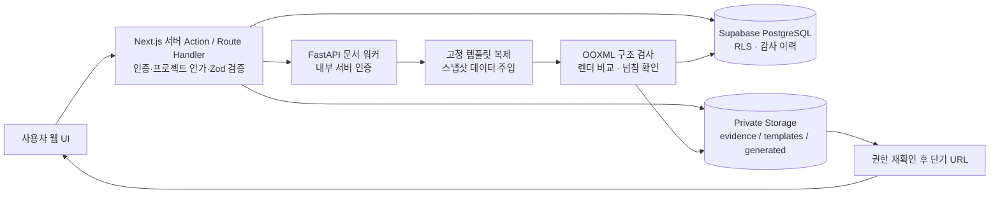
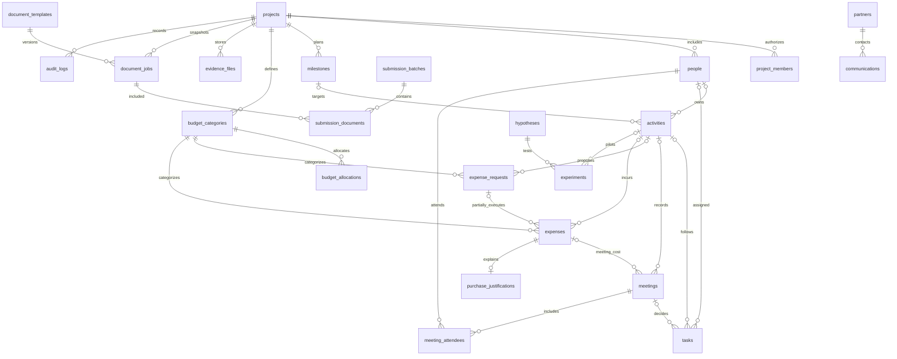

# 데이터 흐름과 DB 관계 설계

설계안이며 M1에는 DB 및 RLS를 생성하지 않는다. 기술 경계는 원 명세를 따른다.

활동을 중심으로 일정·회의·업무·지출을 연결하고, 증빙은 원본 파일 ID를 재사용한다. 일정은 activities의 시작/종료와 milestones 기한을 표시하는 읽기 모델로 시작하여 별도 일정을 중복 입력하지 않는다. people은 업무 담당자·회의 참석자 등 참여 인물, project_members는 로그인 사용자 권한이며 둘은 다르다.

## 테이블 설계 보완

原 명세의 22개 테이블이 기준이다. projects 자체는 id가 프로젝트 루트이므로 자기참조 project_id를 필수로 두지 않는다. project_members.user_id 및 created_by는 Auth 사용자 참조. 담당자는 people, 승인자는 권한 있는 Auth 사용자 참조로 분리한다. 모든 자식에는 project_id와 (project_id,id) unique를 두고 복합 FK로 타 프로젝트 참조를 방지한다.

evidence_files의 target_type+target_id는 일반 FK만으로 무결성을 보장하지 못한다. M2 설계 확정 시 activity_evidence / expense_evidence / meeting_evidence 등 연결 테이블과 복합 FK를 사용한다. 서명은 별도 열람권한을 적용한다. 제출 묶음과 생성 작업은 submission_documents로 N:M을 표현하며 제출 버전과 포함 작업을 동결한다. 이 보완 테이블들은 M1에서 미구현이다.

상태 머신은 원 명세 5절 그대로 적용. enum 상태와 별도로 version 낙관적 잠금과 서버 트랜잭션 기반 audit_logs를 기록한다. 감사 이력은 일반 사용자가 수정/삭제할 수 없게 한다. 거래 삭제 권한은 제공하지 않으며 취소·정정 원거래 참조를 추가하고 금액 계산의 취소/역분개 중복 차감을 금지한다.

## 금액 의미와 부분집행

예산 설정/확정 편성/예정/신청/승인/실집행/정산은 각각 별개다. bigint 원 단위로 저장하고 JSON 경계에서는 정수 문자열로 전달해 큰 정수 정밀도 손실을 막는다.

- allocated: 확정 편성의 현재 유효 버전 합. 여러 편성 버전을 함께 합산하지 않음.
- actual_spent: 취소되지 않은 실제 거래의 순액. 증빙이 없어도 포함.
- remaining_cash_budget = total_budget - actual_spent.
- pending_commitments: 승인 신청별 승인액에서 연결된 유효 집행 합을 뺀 미집행 잔액. 신청별 집계 후 합산하여 JOIN으로 거래가 중복 합산되지 않게 함.
- available_to_commit = total_budget - actual_spent - pending_commitments.
- settled: 정산 승인 완료된 유효 실제 지출 합. 신청 승인과 다름.

5만 원 승인 후 4만 원 집행은 약정 1만 원을 남긴다. 여러 영수증·부분집행을 N개 거래로 연결한다. 승인 취소/잔액 해제는 서버 승인 이력으로만 처리한다. 초과 집행은 경고와 추가 승인 정책 대상이며 이미 발생한 사실을 삭제하지 않는다. M1 화면의 금액은 독립 데모 값, 신규 회계 엔진 구현이 아니다.

## 접근 정책 설계

| 역할   | 일반 조회     | 데이터 작성/수정         | 승인/정산         | 민감 파일                | 설정/양식/권한               |
| ------ | ------------- | ------------------------ | ----------------- | ------------------------ | ---------------------------- |
| owner  | 소속 프로젝트 | 전체 운영                | 기관 기준 충족 시 | 명시 권한                | 전체                         |
| admin  | 소속 프로젝트 | 전체 운영                | 기관 기준 충족 시 | 명시 권한                | 운영 설정, 권한 변경은 owner |
| editor | 소속 프로젝트 | 본인 업무/회의/신청/증빙 | 불가              | 본인 업로드 및 별도 권한 | 불가                         |
| viewer | 일반 정보     | 불가                     | 불가              | 기본 거부                | 불가                         |

활성 project_members + auth.uid() + project_id가 모든 인가의 기준이다. 자기 역할을 승격시키는 UPDATE, 다른 프로젝트로 옮기는 UPDATE를 WITH CHECK로 차단한다. 일반 목록에서 연락처/영수증/서명 경로를 분리한다. 별도 민감정보 테이블/뷰를 설계하고 public view는 security_invoker로 검토한다. 권한은 사용자 편집 가능한 user_metadata를 신뢰하지 않는다.

Storage 세 버킷은 비공개이며 경로 첫 세그먼트 project_id와 멤버십/파일 종류 권한을 검사한다. 사용자 입력 경로로 임의 다운로드하지 않는다. 서버에서 대상 소속을 다시 확인한 후 짧은 유효기간 URL을 발급한다. 서비스 키는 서버 전용이며 문서 워커에도 최소 권한 내부 호출만 허용한다.

M2 게이트: 역할별 CRUD, 비멤버/탈퇴자/타 프로젝트 접근, 위조 project_id, 승인자=요청자 정책, Storage URL 만료, audit 변경 거부 테스트. M1은 공개 데모이므로 실데이터 입력·보관 기능이 없다.

설계 참고: [Supabase RLS](https://supabase.com/docs/guides/database/postgres/row-level-security), [Storage 접근 제어](https://supabase.com/docs/guides/storage/security/access-control).

## V2 운영 구현 (2026-10-30)

상단은 M1 설계 기록이다. 이번 구현은 공통 버전 관리와 가설/실적 간 연결을 먼저 제공하며, 물리 테이블을 다음과 같이 구성했다.

- `somssi_projects`, `somssi_project_members`: 고정 프로젝트와 활성 멤버십. 로그인 사용자와 참여 인물 people을 구분한다.
- `somssi_records`: 프로젝트·도메인 kind·검증된 JSONB payload·created_by·version·생성/수정 시각. 도메인별 필드는 lib/operations/domains.ts, SQL 검증 규칙은 private kind_rules에 고정한다. 자의적인 JSON 문서 쓰기는 허용하지 않는다.
- `somssi_record_links`: 동일 project_id의 record_id와 target_id를 복합 FK로 연결하며 필드별 예상 도메인도 검증한다. 다른 프로젝트/다른 종류/자기 자신을 가리키는 참조를 거부한다.
- `somssi_audit_logs`: 이전/변경 이후 값과 행위자·시각. 기록 변경과 같은 DB 트랜잭션에 append하며 클라이언트 수정/삭제 권한이 없다.
- `somssi_private.write_record`: 명시적 auth.uid()/활성 역할 검사 후 입력 규칙·참조·재무 정정·version을 검증한다. private SECURITY DEFINER 함수는 일반 테이블 쓰기 권한을 대신하는 좁은 경계이며 고정 search_path/권한 취소/역할 검사를 적용했다. 공개 wrapper는 SECURITY INVOKER다.

현재 물리 모델은 모든 도메인을 개별 테이블22개로 분리한 최종 ERD가 아니라, 21개 운영 종류의 검증된 버전 기록과 정규화된 FK 연결을 공통 저장하는 단계다. 향후 물리 테이블을 분리할 때 같은 ID/버전/감사 원본을 보존한다. 이 차이를 명시하며 이전 설계 전체를 완료했다고 주장하지 않는다.

돈은 0.1 같은 부동소수 단위가 아니라 원 단위 정수로 검증하고 DB 계산에서 bigint로 변환한다. JSONB의 수치는 PostgreSQL numeric으로 정확하게 저장되며 앱 경계는 항목별 ±10억 원 범위와 안전 정수 합계를 검사한다. 증감 정정은 원거래를 남기고 추가 기록으로 저장한다. 정정 그룹의 모든 분개를 검토하기 전에는 전체 그룹을 정산 완료 합계에 포함하지 않는다.

역할: owner/admin 전체 운영 수정·정산 검토·감사/백업, editor 자기 생성 기록 수정·거래 기록·자기 원거래 정정, viewer 조회. 결제 완료/지출/증빙은 불변. 증빙 원본은 viewer에게 거부하고 editor는 자기 업로드만, owner/admin은 프로젝트 내 파일을 접근한다. 소속 없는 프로젝트는 읽기/쓰기 모두 차단한다. 멤버십 변경은 관리자 SQL로만 수행하며 감사 트리거를 남긴다.

API → JWT 검증(getUser) → 멤버십 → Zod → 저장 RPC → SQL 검증/관계/버전 → 기록+감사 원자 커밋 → 같은 기록 조회 → Dashboard projection. 디스크 재시작 영속성·다른 프로젝트 FK·버전 충돌·권한·정정 합계는 실제 PostgreSQL 테스트로 확인한다. 실제 클라우드 설치/RLS advisory·Auth·Storage 검증은 운영 프로젝트가 지정된 뒤 필요하다.

## 현재 저장소: 로컬 SQLite (사용자 변경 요청, 2026-10-30)

앞 절의 Supabase 운영 모델은 과거 구현 기록이다. 현재 런타임은 node:sqlite DatabaseSync를 사용하며 프로젝트 루트 `.somssi-local/store.sqlite`와 evidence 폴더에 저장한다. 프로젝트/로컬 사용자/도메인 기록/동일 프로젝트 참조/감사 테이블, WAL과 FK·버전 충돌·불변 원장·정정 합계 검사를 적용한다. 저장과 SQL 감사 트리거는 같은 BEGIN IMMEDIATE 트랜잭션에서 완료한다.

Auth/RLS/클라우드 키를 요구하지 않는다. 로컬 사용자는 감사용 설치 식별값이며 인증/팀별 권한을 뜻하지 않는다. 원격 DB/기존 브라우저 데이터는 자동 이관·덮어쓰기하지 않는다. 전체 백업은 native SQLite snapshot과 증빙 파일/해시 manifest를 포함하며 새 폴더 복구로 원본을 보존한다. 현재 연결·복구 지침과 제한은 LOCAL_STORAGE.md가 우선한다.
